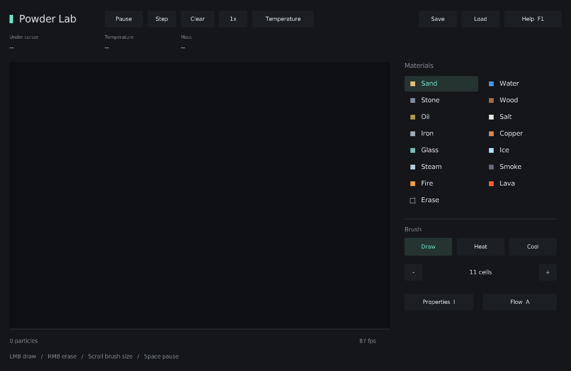
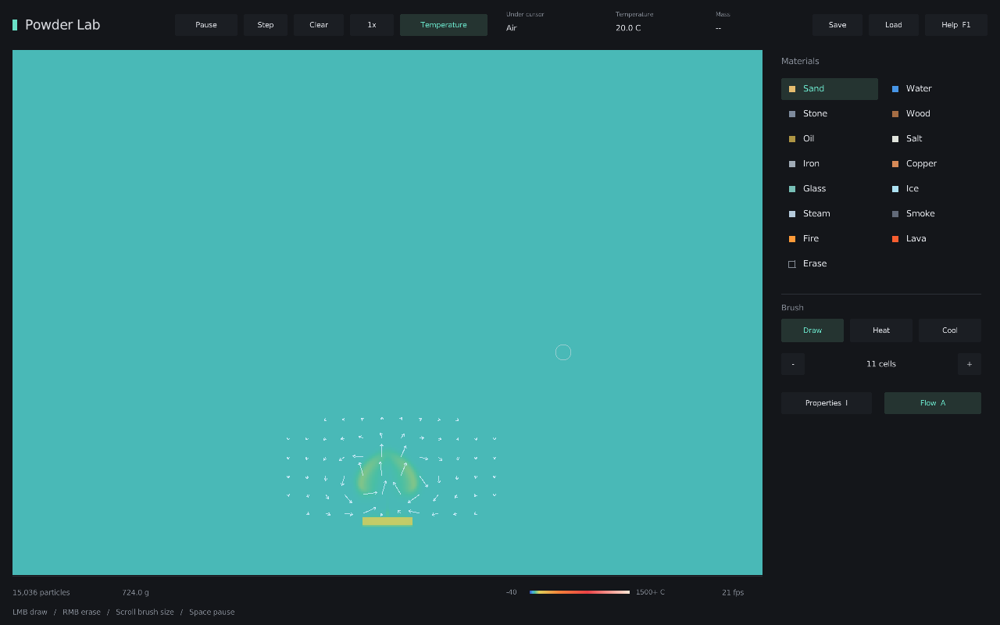
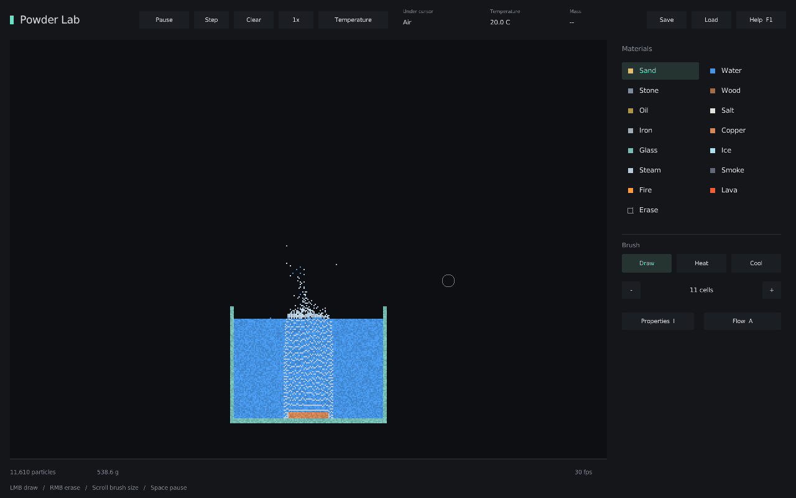
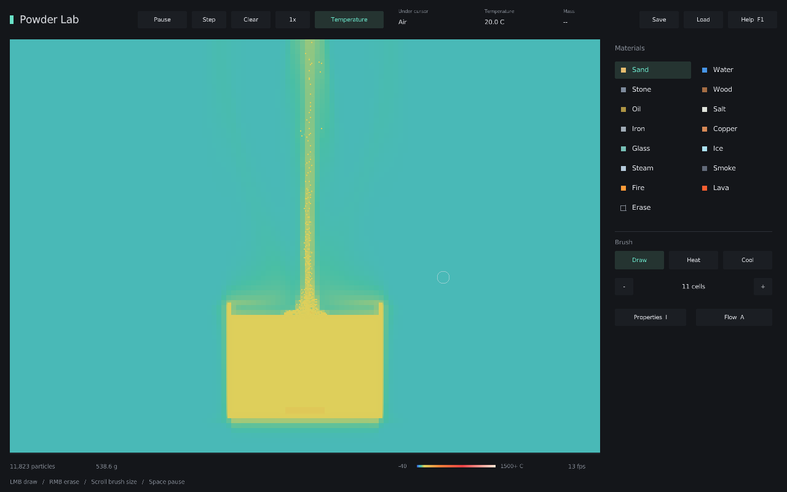
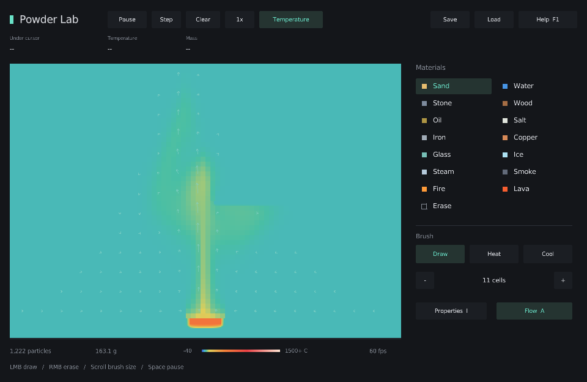

# Powder Lab

Первая версия физической песочницы в духе **The Powder Toy**, написанная на **C# / .NET 10 / Raylib**. Исходный код оригинальной игры не заимствован. Каждая ячейка симуляции отображается квадратом **2 × 2 пикселя**, без сглаживания. Поле — **320 × 224 ячейки** (640 × 448 пикселей), окно — **960 × 624**. По сравнению с прежним полем 480 × 336 число ячеек уменьшено в 2,25 раза.



Игра запускается с **пустым полотном**. Минималистичный интерфейс содержит палитру и основные инструменты; свойства материала открываются вместо палитры кнопкой **Properties** или клавишей `I`. Кнопка **Materials** или повторное `I` возвращает палитру. Демонстрационная сцена загружается отдельно по `R` с подтверждением. Левая, правая и верхняя стороны открыты; твёрдым остаётся только дно.

## Запуск на Windows в VSCode

1. Установите [**.NET 10 SDK x64**](https://dotnet.microsoft.com/download/dotnet/10.0) — именно SDK, а не только Runtime. После установки перезапустите терминал VSCode.
2. Скачайте ZIP репозитория, распакуйте его и откройте **папку с `Powder.csproj`** через **File → Open Folder**.
3. В терминале этой папки выполните:

```powershell
dotnet run
```

Первый запуск загрузит Raylib-cs из NuGet. Нативная библиотека `raylib.dll` входит в пакет: устанавливать C++, Unity, SDL или отдельный Raylib не нужно. Нужны графический рабочий стол и драйвер с **OpenGL 3.3**. Окно не масштабируется, чтобы размер частиц оставался фиксированным; масштабирование Windows и физическая плотность экрана могут влиять на размер изображения на мониторе.

Для более высокой производительности:

```powershell
dotnet run -c Release
```

Для отладки установите расширение **C#** или **C# Dev Kit** и нажмите **F5**. Файлы `.vscode/launch.json` и `tasks.json` уже включены.

Оптимизация расчётов включена и для обычного `dotnet run`. Если для точной пошаговой отладки нужна неоптимизированная сборка, выполните `dotnet build -p:Optimize=false`; расчёт воздуха в такой сборке заметно медленнее.

## Что можно делать

- Рисовать песок, воду, камень, дерево, масло, соль, железо, медь, стекло, лёд, пар, дым, огонь и лаву.
- Строить сосуды и препятствия, смешивать жидкости, наблюдать оседание более плотных частиц.
- Нагревать и охлаждать материалы; при наведении видеть тип, температуру и массу частицы на верхней панели. Свойства выбранного материала доступны отдельно по `I`.
- Плавить лёд и металлы, превращать расплавленный песок в стекло после охлаждения, кипятить воду, масло и расплавы, конденсировать их пары, поджигать дерево и масло, растворять соль.
- Наблюдать конвекцию жидкостей и воздуха: горячая жидкость поднимается с возвратным течением, а теплопроводность постепенно размывает температурные границы. В атмосфере тёплые струи поднимаются, холодный воздух опускается, дым и пар следуют за потоком. `T` показывает температуру материалов **и воздуха**, `A` — стрелки скорости.
- Ставить симуляцию на паузу, выполнять отдельные шаги и менять скорость.
- Сохранять сцену и восстанавливать её. По `R` можно загрузить демо с тремя стендами: гравитация и плотность, медный тепловой мост, горящее дерево.

| Управление | Действие |
|---|---|
| ЛКМ / ПКМ | Рисовать / стирать |
| Средняя кнопка мыши | Взять материал под курсором |
| Колесо мыши, `[` / `]` | Размер кисти |
| `1`–`9` | Быстрый выбор первых девяти материалов |
| `B`, `H`, `J` | Материал, нагрев, охлаждение |
| `Space`, `N` | Пауза, один шаг |
| `T`, `A`, `I` | Термокарта, потоки жидкостей и воздуха, свойства и включение атмосферы |
| `Ctrl+S`, `Ctrl+O` | Сохранить, загрузить |
| `C`, `R` | Очистить поле, загрузить демо; требуется подтверждение |
| `F1` | Открыть / закрыть справку |
| `Esc` | Выйти из игры |

Сцена сохраняется в `%LOCALAPPDATA%\PowderLab\scene-320x224.json`. Формат **v7** содержит материалы, массу, внутреннюю энергию, растворённую соль, скорости частиц, подводные пузырьки, поля скорости жидкостей, энергию конечных объёмов воздуха и скорости на их открытых гранях; загружаются также форматы v1–v6. Сохранение не является точкой точного воспроизведения генератора случайных чисел. Ошибка загрузки сохраняет текущий мир. Прежний `scene.json` остаётся отдельным файлом. Загрузка требует совпадения размеров поля: сохранения 480 × 336 автоматически не обрезаются и не сжимаются. Для своего файла: `dotnet run -- --scene "C:\Scenes\test.json"`.

Интерфейс игры пока на английском; инструкция на русском.

## Физическая модель и её границы

Это **первая игровая модель**, а не инженерный решатель гидродинамики. Справочные коэффициенты — приблизительные значения для типичных материалов; для жидкостей учитывается температурная зависимость плотности и вязкости. Конкретная марка масла, состав лавы или сплава не моделируются.

- Физический масштаб: ячейка 2 мм × 2 мм, глубина среза 1 см; масса при создании равна `ρ × объём`. Гравитационное ускорение — 9,81 м/с², фиксированный шаг — 1/60 с. Масса переносится вместе с частицей и сохраняется при фазовых переходах, растворении и реакции горения. Рисование добавляет вещество, стирание удаляет его; любые движущиеся частицы исчезают после пересечения левой, правой или верхней границы. Дно непроницаемо. Масса и энергия вышедших частиц учитываются отдельно, оборачивания на противоположный край нет.
- В свободном падении порошков и капель жидкости скорость растёт как `v = v₀ + gΔt`, а перемещение считается как `s = v₀Δt + gΔt²/2`. Дробная часть перемещения сохраняется. Проверяется каждая пройденная ячейка, поэтому быстрые частицы не проходят сквозь тонкие стенки. На твёрдом препятствии вертикальная скорость гасится. Свободное ускорение не зависит от массы; разница плотностей определяет вытеснение в жидкостях. Циркуляция внутри жидкости рассчитывается отдельным полем скорости и давления. На свободной поверхности перетекают дробные доли массы, а изображение остаётся клеточным. Твёрдые стены неподвижны. Дым, пар и огонь подхватываются воздухом с конечным временем смешения; подводные пузырьки дополнительно всплывают относительно жидкости.
- Нагрев и охлаждение работают через **мощность 20 Вт на покрытую ячейку**: `Q = PΔt`, а вне фазовых переходов `ΔT = Q/(m × c)`. Одинаковая подведённая энергия даёт разный рост температуры у разных масс и теплоёмкостей. Время нагрева распределяется между точками штриха; изменение частоты кадров и количества промежуточных точек не умножает мощность. Инструмент работает и на паузе.
- Теплопроводность следует закону Фурье: `P = G × ΔT`, где `G = A / (dx/(2k₁) + dx/(2k₂))`. Тепловые сопротивления половин соседних ячеек складываются. Парный обмен решается с учётом `m × c` до ближайшей фазовой границы, затем продолжается с новыми свойствами и оставшимся временем. На участках скрытой теплоты температура остаётся постоянной. Переданная энергия вычитается из горячей частицы и добавляется холодной; выравнивание температур не создаёт перегрева. Два чередующихся тепловых прохода за шаг уменьшают погрешность последовательной обработки соседей. **Фиксированное остывание к 20 °C удалено.** Поверхности обмениваются энергией с соседними ячейками воздуха, имеющими конечную теплоёмкость. Потерянная материалом энергия добавляется воздуху; нагретый воздух может передать её другим материалам. Внутри замкнутого сосуда тепло не удаляется таймером.
- Вода использует энтальпию и скрытую теплоту плавления 334 кДж/кг и испарения 2256 кДж/кг, с плато 0 и 100 °C при атмосферном давлении. При кипении очередная порция скрытой теплоты `Q` создаёт `Δm = Q/L` пара, сохраняя остаток жидкости при температуре кипения. Мелкие пузырьки учитываются отдельно от жидкой ячейки; масса и энергия распределяются между фазами. Объёмное расширение пара, давление внутри пузырьков и сжимаемость не рассчитываются.
- Плавление меди, железа, камня, стекла и песка учитывает энергетический бюджет перехода. Расплав отображается как **Lava**. Медь и железо после охлаждения возвращаются в свой материал, а **песок превращается в стекло**, которое можно снова расплавить. Разницу теплоёмкостей песка и стекла учитывает сохраняемая точка отсчёта энтальпии: преобразование не добавляет энергию и не вызывает скачка температуры на границе затвердевания. Размягчение и стеклование кремнезёма представлены упрощённым переходом около 1700 °C; вязкость зависит от температуры, а отжиг пока не моделируется. Теплоёмкость, теплопроводность, плотность и вязкость расплавов зависят от исходного материала.
- Горение — упрощённый источник химической энергии; доступ кислорода считается неограниченным. Масса топлива становится массой продуктов горения. Кинетика реакций и состав дыма приближённые. Нарисованный огонь — кратковременный источник зажигания; надёжнее нагреть топливо инструментом **Heat**.
- Соль растворяется с сохранением массы и энергии, увеличивает плотность рассола и переносится течением. При испарении она остаётся в растворе, а после полного выкипания воды выпадает твёрдым остатком. Изменение точек замерзания и кипения рассола, равновесная кристаллизация и химия растворов пока не реализованы. Точное движение свободной поверхности, капиллярные силы, ударные волны, сжимаемость воздуха, объёмное расширение пара и изменение концентрации кислорода остаются для следующих версий.

## Жидкости: теплопроводность и конвекция

В воде, масле и каждом типе расплава действуют **два разных механизма переноса тепла**. Теплопроводность передаёт энергию соседям по закону Фурье с реальными `k` и `m × c`; скорость распространения определяется температуропроводностью `α = k/(ρc)`. Течение переносит вместе массу, энтальпию, растворённую соль и энергетическую точку отсчёта материала. Поэтому нагретая область может подняться, сохраняя большую часть своего тепла, вместо мгновенного выравнивания температуры всего сосуда.

- Поле течения использует MAC-сетку **на каждой ячейке частиц**, перенос импульса, тепловую плавучесть в приближении Буссинеска, неявный расчёт вязкости и проекцию давления. Проекция формирует циркуляцию с возвратным потоком, а не просто сдвигает горячие ячейки вверх. Гидростатическая часть силы уравновешивается перед вязкостью, чтобы неподвижная жидкость и устойчивая слоистость не создавали ложных вихрей.
- Плотность чистой воды имеет максимум около **4 °C**. Вода при 0 °C легче воды при 4 °C; при обычных температурах нагрев уменьшает плотность. Рассол плотнее чистой воды. Вязкость воды и масла уменьшается при нагреве; силикатный расплав гораздо вязче расплавленного металла.
- Тепловой перенос потоком — консервативная схема конечных объёмов с дроблением шага по CFL. Энергия, ушедшая из одной ячейки, поступает другой. Масса и теплоёмкость переносятся совместно, поэтому перенос не создаёт температур выше самого горячего или ниже самого холодного донора. Фазовые переходы по-прежнему требуют скрытой теплоты.
- Между разными жидкостями тепло проходит через суммарное сопротивление двух половин ячеек. Каждая несмешивающаяся жидкость имеет собственную область циркуляции; тяжёлая жидкость вытесняет лёгкую клеточными обменами. Твёрдая стенка толщиной в одну ячейку блокирует течение, но проводит тепло в соответствии со своим материалом.
- Растекание у свободной поверхности переносит дробные порции массы, энергии и соли в менее заполненные соседние ячейки. Направление задаётся гравитацией и разницей заполнения, а подвижность зависит от вязкости. Остаток после испарения постепенно восполняется соседней жидкостью; для этого не требуется случайно перебрасывать целую водную ячейку через канал пара.

Приближённые параметры:

| Жидкость | Теплоёмкость, Дж/(кг·К) | Теплопроводность, Вт/(м·К) | Динамическая вязкость, Па·с |
| --- | ---: | ---: | ---: |
| Вода, 20 °C | 4184 | 0,60 | 0,0010 |
| Минеральное масло, 20 °C | 2000 | 0,15 | 0,05 |
| Каменная лава, 1450 °C | 1200 | 2 | около 25 |
| Расплав меди, около 1085 °C | 520 | 160 | около 0,004 |
| Расплав железа, около 1538 °C | 820 | 35 | около 0,006 |
| Кремнезём, около 1700 °C | 1200 | 1,5 | около 1 000 000 |

**Ограничения:** это гибридная двумерная модель. Проекция рассчитывает циркуляцию в текущем объёме жидкости с нулевым нормальным потоком на его границе; падение капель, дробное растекание массы и разделение несмешивающихся жидкостей обрабатываются отдельно. Подвижная свободная поверхность и интерфейсы не решаются полным методом VOF, поэтому волны, брызги и взаимодействие струй пока приближённые. Подвижность поверхности связана с `g`, размером ячейки и кинематической вязкостью; тончайшие плёнки меньше разрешения сетки не отображаются отдельными клетками. Тепловое расширение влияет на плавучесть, но не увеличивает геометрический объём жидкости. У переноса первого порядка есть численная диффузия; потери кинетической энергии от вязкости не превращаются в тепло. При нагрузке игра ограничивает число шагов за кадр, сохраняя отзывчивость управления и фиксированный физический шаг; ход времени симуляции может замедляться относительно реального. Мощность кисти ограничивается тем же доступным временем симуляции.

Для наблюдения конвекции запустите отдельный сосуд с тёплой областью воды и медным нагревателем. Их запас энергии конечен; постоянной заданной температуры нет. Обычный запуск остаётся пустым:

```powershell
dotnet run -c Release -- --liquid-demo
```

Нажмите `T` для термокарты и `A` для стрелок течения; в этой демонстрации оба режима включены сразу.



## Кипение и конденсация

Все доступные жидкости переходят в газ при своей температуре кипения. Значения заданы для атмосферного давления:

| Жидкость | Температура кипения, °C | Скрытая теплота испарения, МДж/кг |
| --- | ---: | ---: |
| Вода | 100 | 2,256 |
| Масло | около 350 | 0,25 |
| Расплав меди | 2562 | 4,73 |
| Расплав железа | 2862 | 6,09 |
| Каменная лава | около 2800 | 5 |
| Расплав песка / стекла | около 2950 | 9 |

Кипение начинается с первой подведённой порции скрытой теплоты: при 100 °C добавление воде энергии `Q` испаряет массу `Δm = Q/L`. Ждать энергии на испарение всей ячейки не требуется. Оставшаяся вода сохраняет температуру 100 °C, пока жидкая и газовая фазы сосуществуют. Само достижение 100 °C без дополнительной энергии не испаряет вещество: скрытая теплота по-прежнему учитывается. После полного перехода дальнейший нагрев повышает температуру газа. Для масла и расплавов действует та же схема со своими температурой кипения и `L`.

Подводный пар хранится в отдельном слое **Bubbles** как порции массы и энтальпии мелких пузырьков, размер которых сетка напрямую не разрешает. Пузырёк может находиться в той же ячейке, что и жидкость: его появление не удаляет целую водную клетку и не прокапывает канал. Он движется с течением и всплывает относительно него; скорость зависит от плотности, вязкости и характерного диаметра пузырька. В более холодной жидкости пузырёк отдаёт энергию, постепенно конденсируется и возвращает массу в жидкость. У свободной поверхности он переходит в обычный газовый слой. Масса и энергия учитываются в обоих слоях, в файле сцены и в бюджете вышедшего вещества.

Водяной пар отображается как **Steam**. Остальные пары получают название своего вещества в верхней панели: **Oil vapor**, **Copper vapor**, **Iron vapor**, **Rock vapor**, **Silica vapor**. Пары обмениваются теплом с материалами и атмосферой, следуют за воздушным потоком и исчезают за открытыми краями с учётом массы и энергии. Конденсация возвращает воду, масло или исходный расплав и освобождает соответствующую скрытую теплоту. После дальнейшего охлаждения металлические расплавы твердеют в соответствующий металл, а кремнезём — в стекло. Состав и энергетическая точка отсчёта сохраняются в файле сцены. Соль не переносится в пар: раствор концентрируется, а при полном выкипании остаются кристаллы. Температура кипения выбранного материала видна в панели **Properties**.

Отдельная демонстрация: вода при 100 °C над медной пластиной, нагретой до 130 °C. Запас энергии пластины конечен; для продолжения кипения используйте инструмент **Heat**. Обычный запуск открывает пустое полотно:

```powershell
dotnet run -c Release -- --boiling-demo
```



Масло может дойти до кипения; самовоспламенение перегретого масляного пара в этой модели происходит выше 400 °C. Доступ кислорода считается неограниченным. Для масла, каменной лавы и кремнезёма это условные однокомпонентные вещества: реальные смеси испаряются в диапазоне температур и могут разлагаться. Кипение рассчитано при постоянном наружном атмосферном давлении. Зависимость температуры кипения от давления, поверхностное испарение ниже точки кипения, сжимаемый газ, его объёмное расширение и давление пузырьков на свободную поверхность пока не рассчитываются.

## Атмосфера и конвекция

Воздух — отдельное непрерывное поле, а не материал кисти. По умолчанию он невидим и имеет температуру 20 °C. Включите `T`, чтобы увидеть нагретые струи, и `A`, чтобы увидеть направление потока. Кнопка **Flow** показывает белые стрелки в жидкости и зелёные в воздухе; длины имеют разные визуальные масштабы, поскольку жидкость обычно движется медленнее. При наведении на свободное пространство верхняя панель показывает **Air** и местную температуру; массы отдельной воздушной частицы у такого поля нет. Переключатель **Atmosphere** в свойствах отключает расчёт для сравнительных экспериментов; при обычном запуске он включён.

- Атмосфера использует **метод конечных объёмов с границами по геометрии частиц**. В полностью свободном блоке расчётный объём покрывает 4×4 частицы. Частично занятый блок разделяется на отдельные воздушные объёмы размером с частицу — **2×2 пикселя**. Внутри материала воздушных объёмов нет; пустые места и одноклеточные щели участвуют в расчёте.
- Грани соединяют только непосредственно соприкасающиеся воздушные объёмы. Их площадь равна реальной открытой площади прохода. По разные стороны тонкой стенки сохраняются отдельные неизвестные давления и температуры, даже если стенка проходит внутри одного крупного блока. Геометрия точна относительно квадратов частиц; произвольная гладкая поверхность остаётся ступенчатой с разрешением 2 мм.
- Объём задаёт массу воздуха `m = ρV` и теплоёмкость `m × c`. Скорость хранится на открытых гранях. Проекция давления уравновешивает объёмные потоки с учётом площади граней и размера каждого объёма. Учитываются перенос импульса, молекулярная вязкость и вязкое торможение возле стен. Тепловая плавучесть создаёт подъём горячего воздуха и возвратное течение холодного, включая узкие проходы.
- Тепло переносится консервативными потоками через грани ячеек; шаг переноса дробится по условию CFL. Есть также теплопроводность самого воздуха. Внутренний обмен не создаёт и не удаляет тепло. Температура 20 °C задаётся начальному состоянию и внешнему воздуху за открытыми краями; исходящий воздух уносит своё тепло. Поверхность материала непосредственно на открытом краю обменивается теплом с внешней атмосферой, и этот поток также учитывается как вышедшее тепло. Нижняя граница непроницаема и теплоизолирована.
- Параметры воздуха: плотность около 1,204 кг/м³, теплоёмкость 1005 Дж/(кг·К), теплопроводность 0,0257 Вт/(м·К), кинематическая вязкость 1,5×10⁻⁵ м²/с. В тепловом балансе хранится энергия воздуха относительно наружных 20 °C, а вышедшее тепло считается отдельно.
- Материал обменивается теплом непосредственно с прилегающим воздушным объёмом. Затем энергия распространяется теплопроводностью и потоком через открытые грани. Для мелких и крупных объёмов применяется одна схема; согласование потоков сохраняет энергию. Через стену тепло проводит сам материал.
- При изменении геометрии энергия переносится по пересечению старых и новых объёмов. Вытесненное тепло передаётся непосредственно соседнему воздуху, а при полном отсутствии свободных соседей сохраняется до открытия пространства. Термокарта и верхняя панель показывают температуру тех же конечных объёмов. Сохранение учитывает правки материалов на паузе.



Модель описывает двумерную естественную конвекцию при малых скоростях с постоянными справочными коэффициентами. Между центрами объёмов используется двухточечная аппроксимация потоков и перенос первого порядка. Расширение газов, акустика, излучение, турбулентность малых масштабов и превращение потерь кинетической энергии в тепло пока не рассчитываются. При перестроении геометрии работа движущейся стенки как поршня отдельно не учитывается. При очень высоких температурах плотность для плавучести — приближение.

Отдельная сцена для наблюдения конвекции: нагретая медная пластина и стеклянное препятствие над ней. Обычный запуск по-прежнему открывает пустое полотно.

```powershell
dotnet run -c Release -- --air-demo
```



## Производительность

Тепловой обмен и движение обходят занятые ячейки; отдельный список активных пузырьков исключает полный проход их слоя на каждом шаге. Воздушные грани строятся по периметрам конечных объёмов; внутренность свободных блоков не требует отдельного перебора граней частиц. Для давления воздуха применяется многоуровневое предобусловливание, а для малых областей — IC(0). Иерархия создаётся при необходимости решения и сохраняется до изменения геометрии. При движении материалов предыдущее давление переносится в новые объёмы как начальное приближение.

Размеры объёмов, площади проходов, физический шаг и пороги точности сохранены. CFL по-прежнему учитывает мелкие объёмы у стенок. Повторяющиеся коэффициенты переноса и трения у стен вычисляются один раз на шаг; цвет термокарты воздуха — один раз на объём при обновлении полотна. На паузе физические шаги не выполняются, неизменившееся полотно переиспользует текстуру. Оптимизация включена и при обычном `dotnet run`; большие активные сцены всё равно могут замедлять симуляцию.

Воспроизводимое измерение без окна запускает три сцены размером 320 × 224: пустое поле, нагреваемый сосуд с водой и общую демосцену. Каждая получает 30 шагов прогрева и 180 измеряемых шагов. Отчёт содержит время шага по часам и CPU, медиану, 95-й процентиль, выделения памяти и состояние сцены. Время сборки в измерение не входит:

```powershell
dotnet run -c Release -- --benchmark --benchmark-output artifacts\benchmark.json
```

Для одной сцены добавьте `--benchmark-scene empty`, `--benchmark-scene water-boiling` или `--benchmark-scene demo`. Для прежнего размера поля задайте `--benchmark-width 480 --benchmark-height 336`. Геометрия встроенных стендов масштабируется под выбранное поле. Результаты предназначены для сравнения на одном компьютере при одинаковой нагрузке; жёсткого временного порога в тестах нет.

После уменьшения поля с 480 × 336 до 320 × 224 время физического шага в облачном замере сократилось с **44,57 до 15,42 мс** при кипении и с **89,55 до 41,28 мс** в общей демосцене: ускорение примерно в **2,9 и 2,2 раза**. Стенды также уменьшены, поэтому сравниваются сцены с сопоставимой долей заполнения, а не одинаковым количеством вещества. В графическом прогоне `--boiling-demo` средняя скорость выросла с **16,28 до 39,10 FPS** на Linux с программным OpenGL. Это результат конкретного прогона; на Windows и в других сценах прирост будет отличаться, игра ограничена 60 FPS. [Методика и исходные отчёты](docs/PERFORMANCE.md).

## Проверки и сборка Windows

Проверки физики работают без окна и графического дисплея:

```powershell
dotnet run -c Release -- --self-test
```

Они проверяют ускорение и траекторию свободного падения, столкновения без прохождения сквозь препятствия, плотность, сохранение массы и энергии, мощность нагревателя, теплоёмкость, тепловое сопротивление, скрытую теплоту, цикл песок → расплав → стекло, плавление металлов, растворение, горение, сохранения и численную устойчивость демосцены. Для воздуха проверяются подъём и опускание, циркуляция, непроницаемость стен, тепловой баланс и открытые края. Для жидкостей — аналитическое решение парного теплообмена, затухание температурной волны по `α = k/(ρc)`, подъём горячей и опускание холодной воды, аномалия плотности около 4 °C, возвратное течение, устойчивая стратификация, конвекция масла и расплавов, вязкость, перенос соли и общий баланс с атмосферой.

Проверки кипения охватывают первый дробный пар после подвода скрытой теплоты, соотношение `Δm = Q/L` для каждого типа жидкости, всплытие и конденсацию подводных пузырьков, возвращение конденсата в жидкость, сохранение соли и отсутствие устойчивой воронки после прекращения локального нагрева. Также проверяются теплообмен через фазовые плато, охлаждение пара кремнезёма в стекло, состав пара, его выход через открытые края и сохранение пузырьков в файле сцены. Ненулевой код возврата означает ошибку.

Дополнительные проверки воздуха охватывают точный свободный объём у криволинейной стенки и неровного края поля, нагрев одноклеточного кармана, течение и перенос тепла через щель шириной в одну частицу, циркуляцию в узких каналах, непроницаемость стенки внутри крупного блока, аналитическую кривую теплопроводности, баланс при перестройке и сохранение правок на паузе.

Формат **v7** сохраняет энергию конечных объёмов воздуха и скорости всех открытых граней вместе с основными частицами, составом пара, энергетической точкой отсчёта стекла, дробным перемещением, пузырьками и течением жидкости. Поддерживается загрузка **v1–v6**: тепло старой воздушной сетки и карманов переносится в новые объёмы с сохранением энергии. Отсутствующее течение начинается с нулевой скорости, отсутствующая атмосфера — с 20 °C, отсутствующий слой пузырьков — пустым. Для старых расплавов металлов пересчитывается энтальпия под новую теплоёмкость с сохранением температуры. Старые перегретые жидкости подчиняются новым границам кипения без добавления энергии на испарение.

Короткий графический прогон с проверкой пустого старта, инструментов, панели свойств, очистки и сохранения:

```powershell
dotnet run -c Release -- --smoke-test --screenshot artifacts\smoke.png
```

Самостоятельная Windows x64 сборка, которая не требует установки .NET Runtime:

```powershell
dotnet publish -c Release -r win-x64 --self-contained true -o artifacts\windows
```

Запускайте `artifacts\windows\Powder.exe`. Для ZIP с готовой игрой **и исходниками, включая `.csproj`**, выполните:

```powershell
powershell -File scripts\package-windows.ps1
```

Результат: `artifacts\PowderLab-0.1.0-windows-x64.zip`. Скрипт запускается с обычной политикой выполнения локальных PowerShell-скриптов.

## Структура

`Simulation/` — независимая от графики физика и формат сцены; `UI/` — окно, инструменты и отрисовка; `Tests/` — запускаемые проверки; `Assets/` — шрифт с лицензией. Проект также собирается на Linux x64 и macOS x64/ARM64; нужны библиотеки рабочего стола и OpenGL. На Debian/Ubuntu обычно достаточно `libgl1 libx11-6 libxrandr2 libxinerama1 libxcursor1 libxi6` и активного дисплея.

Код Powder Lab распространяется по MIT. Лицензии зависимостей перечислены в [THIRD_PARTY_NOTICES.md](THIRD_PARTY_NOTICES.md).
